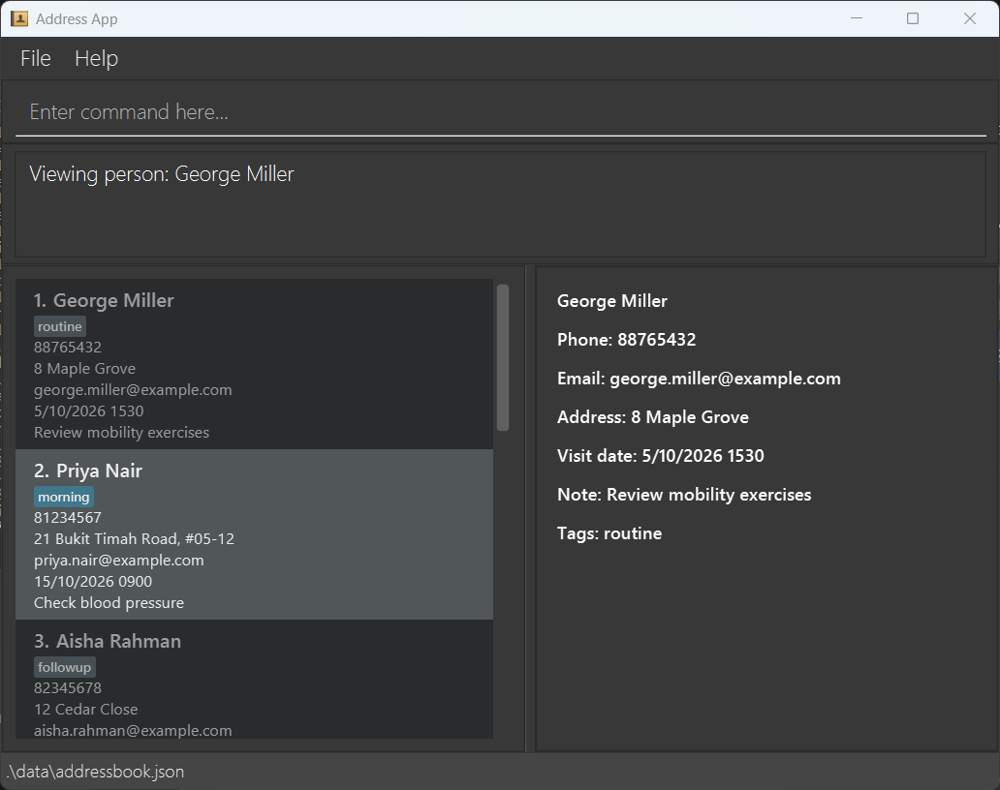

# Doc

**Doc is a desktop application for house call doctors to keep track of the patients they visit at home.**

A house call doctor sees the same patients over and over, often 4-10 home visits a day, and needs a patient's address, contact number and ongoing conditions at hand before knocking on the door. Doc keeps all of that in one place, so the next visit can be planned in seconds instead of being pieced together from memory and scattered notes.

Doc is optimised for users who are fast typists: most interactions happen through a Command Line Interface (CLI), while the results stay visible in a Graphical User Interface (GUI).

## Features

Doc v1.6 supports the following features:

* Keep patient contact details, medical information, tags and notes in one record.
* Find patients by name, phone number, address, tag, current visit date or notes.
* Sort the displayed patients by current visit date and time around today or a chosen start date.
* View an agenda of current visits over a chosen date range.
* Schedule the next visit while retaining previous visit dates, and restore the latest previous visit when needed.
* Prevent patients from being assigned the same current or previous visit date and time.

Doc is a record-keeping and planning tool. It does not handle communicating with patients.

## Documentation

* [User Guide](https://ay2627s1-cs2103t-t09-4.github.io/tp/UserGuide.html) - how to install Doc, and the full command reference.
* [Developer Guide](https://ay2627s1-cs2103t-t09-4.github.io/tp/DeveloperGuide.html) - the design and implementation, for anyone contributing to Doc.
* [About Us](https://ay2627s1-cs2103t-t09-4.github.io/tp/AboutUs.html) - the team behind Doc.

## Acknowledgements

This project is based on the AddressBook-Level3 project created by the [SE-EDU initiative](https://se-education.org).

Libraries used: [JavaFX](https://openjfx.io/), [Jackson](https://github.com/FasterXML/jackson), [JUnit 5](https://github.com/junit-team/junit-framework).
