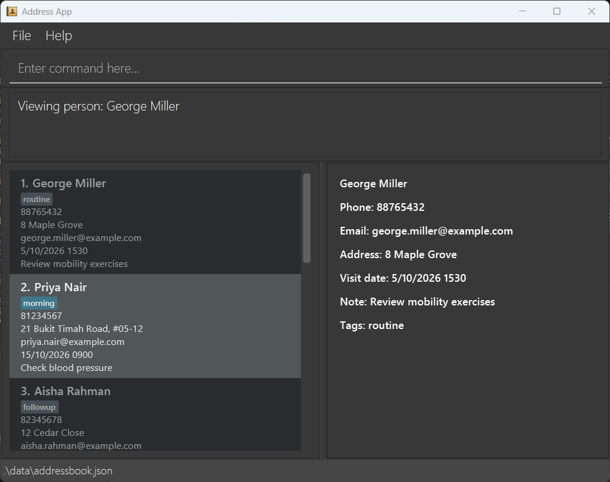
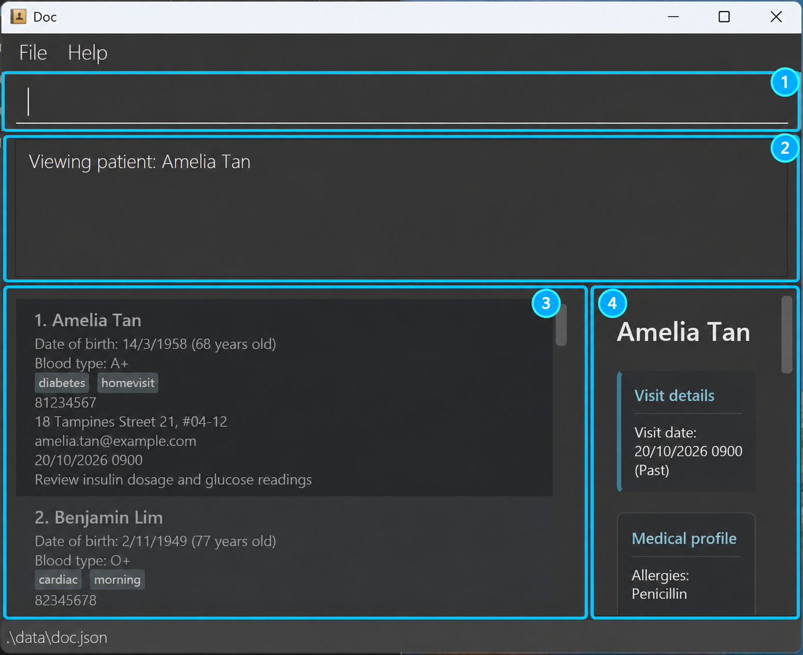
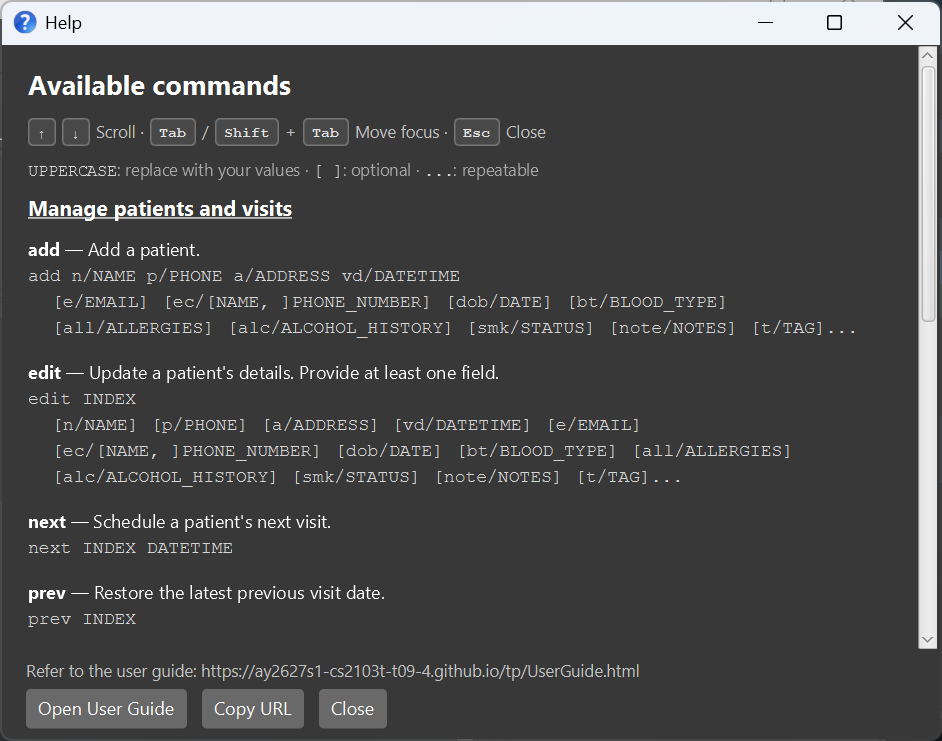

# Doc User Guide

Doc is a **desktop application for house-call doctors to manage patient records and plan home visits**. It is
optimized for use through a Command Line Interface (CLI) while retaining the benefits of a Graphical User Interface
(GUI). If you type quickly, Doc can help you manage your caseload faster than traditional GUI applications.

<!-- * Table of Contents -->
<page-nav-print />

--------------------------------------------------------------------------------------------------------------------

## Quick start

1. Ensure that Java `25` or later is installed on your computer. 
   **Mac users:** Ensure you have the precise JDK version prescribed [here](https://se-education.org/guides/tutorials/javaInstallationMac.html).

1. Download the latest `.jar` file from [here](https://github.com/AY2627S1-CS2103T-T09-4/tp/releases).

1. Copy the file to the folder you want to use as the _home folder_ for Doc.

1. Open a terminal, `cd` to the folder containing the JAR file, and run `java -jar doc.jar`. 
   If your downloaded JAR has a different filename, replace `doc.jar` with that filename. 
   A GUI similar to the one below should appear in a few seconds. When no saved data file exists, Doc starts with
   ten sample patient records: Amelia Tan, Benjamin Lim, Chloe Ng, David Koh, Farah Aziz, Grace Wong, two patients
   named Jordan Lee, Kavita Rao, and Lucas Chen. 
   

1. Type a command in the command box and press <kbd>Enter</kbd> to execute it. For example, type **`help`** and press <kbd>Enter</kbd> to open the help window. 
   Some example commands you can try:

   * `list` : Lists all patients.

   * `add n/John Doe p/98765432 a/123 Clementi Road vd/18/9/2026 1000` : Adds a patient named `John Doe` to Doc.

   * `delete 3` : Asks for confirmation before deleting the 3rd patient shown in the current list.

   * `clear` : Asks for confirmation before deleting all patient records.

   * `exit` : Exits the app.

1. Refer to the [Features](#features) section below for details of each command.

--------------------------------------------------------------------------------------------------------------------

## Features

<box type="info" seamless>

**Notes about the command format:** 

* Words in `UPPER_CASE` are the parameters to be supplied by the user. 
  For example, in `add n/NAME`, replace `NAME` with a value such as `John Doe`.

* Items in square brackets are optional. 
  For example, `n/NAME [t/TAG]` can be used as `n/John Doe t/friend` or as `n/John Doe`.

* Items followed by `...` can appear zero or more times. 
  For example, `[t/TAG]... ` may be omitted, or written as `t/friend` or `t/friend t/family`.

* Prefixed fields can be in any order after any required positional arguments. 
  For example, if the command specifies `n/NAME p/PHONE`, `p/PHONE n/NAME` is also acceptable.

* Prefixes are recognized at the start of the arguments or after whitespace, including spaces, tabs, and line breaks.
  A prefix-looking token separated by whitespace starts a new field; there is no quoting or escaping for literal
  prefix text inside a field value.

* Positional arguments must follow the command's documented order. 
  For example, `edit INDEX ...` starts with the index, and `next INDEX DATETIME` requires the index before the date
  and time.

* Commands that take an `INDEX` (`view`, `edit`, `delete`, `next`, and `prev`) explain an invalid index the same way.
  These messages are followed by the command's usage: `Invalid command format!` for a missing index,
  `Index must be a positive integer.` for an index that is zero, negative, or not a whole number, and
  `Index is too large.` for an index too large to represent. An index beyond the displayed list shows
  `The patient index provided is invalid.` The last two messages also ask you to enter an index shown in the
  displayed patient list. For `view`, `edit`, `delete`, and `prev`, extra text after a valid index, such as
  `view 1 2`, shows `Unexpected arguments after the index.` followed by the command's usage.

* Extraneous parameters for commands that take no parameters, such as `help`, `list`, `exit`, and `clear`, are ignored. 
  For example, `help 123` is interpreted as `help`.

* If you are using a PDF version of this document, be careful when copying and pasting commands that span multiple lines as space characters surrounding line-breaks may be omitted when copied over to the application.
</box>

### Visit records

Each patient has one required **current visit date and time** and zero or more **previous visit dates**.
Together, these form the patient's **visit record**. The current datetime can be past, present, or future.
Previous dates are stored oldest first and displayed newest first by [view](#viewing-a-patient-s-details-view).
Notes belong to the patient; separate notes are not stored for each visit. Retained datetimes do not verify
attendance, cancellation, or completion.

Choose the command according to what you want to change:

| Goal | Command | Effect on the visit record |
| --- | --- | --- |
| Correct or reschedule the current appointment. | [edit](#editing-a-patient-edit) `INDEX vd/DATETIME` | Set the current visit date and time to `DATETIME`; leave Previous visit dates unchanged. |
| Plan or record the following visit after the current visit time has arrived. | [next](#scheduling-the-next-visit-next) `INDEX DATETIME` | Move the current visit date and time to Previous visit dates, then set an unused later date and time as current; confirm if the new visit time is now or has passed. |
| Restore the most recent previous visit date and time. | [prev](#restoring-the-previous-visit-prev) `INDEX` | Remove the most recent entry from Previous visit dates and make it current; discard the visit date and time it replaces. |
| Leave a final visit recorded without planning another. | No command needed. | Keep the current visit date and time recorded, even after it is marked `Past`. |

Successful `edit`, `next`, and `prev` commands preserve the current filtering and sorting. The updated patient may
move within the list or disappear if the changed details no longer match those rules. The details panel automatically
shows the updated patient and refreshes the record and its calendar label. Run `list` to return to the full list.

When `next` moves an appointment to a different day that already has seven or more current appointments, Doc asks for
confirmation. Patients hidden by filtering still count, but previous visit history does not. Moving the appointment to
a later time on the same day does not trigger this warning.

### Navigating the main window by keyboard

**1** Command box · **2** Response panel · **3** Patient list · **4** Patient-details panel

When the main window is active, press <kbd>Tab</kbd> to move through the four main sections in this order: command box,
response panel, patient list, and patient-details panel. Pressing <kbd>Tab</kbd> from the patient-details panel returns
to the command box. Press <kbd>Shift</kbd>+<kbd>Tab</kbd> to move in reverse order, returning from the command box to
the patient-details panel. A visible light-gray outline surrounds the section that currently contains keyboard focus: command box,
response panel, patient list, or patient-details panel. The outline remains visible for empty sections; labels and the
patient-details scrollbar are not separate <kbd>Tab</kbd> destinations. The menu bar is outside this four-section cycle.

With the patient-details panel focused, use <kbd>Up</kbd> and <kbd>Down</kbd> to scroll by a small increment,
<kbd>Page Up</kbd> and <kbd>Page Down</kbd> to scroll by approximately one screenful of details, and <kbd>Home</kbd> and
<kbd>End</kbd> to move to the top and bottom. These scrolling keys have no effect when the panel is empty or all
details already fit. <kbd>Up</kbd> and <kbd>Down</kbd> keep their existing command-history behavior in the command box
and patient-list navigation behavior in the patient list.
In the patient list, <kbd>Up</kbd> and <kbd>Down</kbd> move the selection and scroll only as needed to keep the selected patient card fully
visible.

### Reading command responses

The response panel has a fixed height, so resizing the application window does not change the space allocated to
feedback. Long success and error messages wrap within the panel. If a message is taller than the panel, use its
vertical scroll bar or focus the panel and press <kbd>Up</kbd> and <kbd>Down</kbd> to read the remaining text.

After every successful `view INDEX`, the patient-details panel returns to the top, including when viewing another
patient or viewing the same patient again. Entering `view INDEX` in the command box leaves the cursor in the command box.

### Navigating command history

The command box keeps commands submitted during the current application session so that you can reuse or edit them.

* Press <kbd>Up</kbd> to recall the most recently submitted command. Press it again to move to older commands. The
  oldest command remains displayed when there are no earlier commands.
* Press <kbd>Down</kbd> to move towards newer commands. After the newest command, pressing <kbd>Down</kbd> restores the
  unfinished text that was in the command box before you started browsing.
* Commands are recalled exactly as submitted, including spaces. Consecutive commands with exactly the same text are
  kept as one history entry so that navigation does not appear unresponsive. The same command is kept again when
  another command separates the submissions. Both successful and invalid commands are kept.
* Empty ordinary submissions and responses to follow-up prompts, such as `y` for a deletion confirmation, are not
  kept. While a follow-up prompt is pending, any recalled text you submit is still handled as the response to that
  prompt.
* Submitting a new command returns navigation to the newest command. The history is cleared when the application
  closes.

### Viewing help: `help`

Opens a separate help window listing **Available commands** in one column. The offline reference provides
short descriptions, syntax templates, optional fields, and a notation legend for quick lookup while entering
commands. Detailed validation rules and examples remain in the command sections below.

Format: `help`

You can also press <kbd>F1</kbd> or choose **Help → Help** (<kbd>F1</kbd>). Repeating a help request brings the existing
window to the front, restoring it if minimized. You can resize Help and continue using the main window.

* **Browse commands:** The command list receives keyboard focus when Help opens. Use <kbd>Up</kbd> and <kbd>Down</kbd> to scroll through the
  command reference, or <kbd>Home</kbd> and <kbd>End</kbd> to reach the top and bottom. The User Guide URL and buttons stay below the list.
* **Read the full guide:** Choose **Open User Guide** to open it in your default browser. This requires
  an Internet connection. Doc's browser-opening message does not guarantee that the page loaded. If nothing opens,
  choose **Copy URL** and paste the address into your browser. If copying fails, retry or enter the displayed URL manually.
* **Close Help:** Choose **Close**, press <kbd>Escape</kbd>, or use the window's close control. Focus returns to the
  command box with your unfinished input unchanged. For example, type `find n/Be`, press <kbd>F1</kbd>, then close Help
  to continue editing the same draft.

Use <kbd>Tab</kbd> and <kbd>Shift</kbd>+<kbd>Tab</kbd> to move between the command list and buttons. Press <kbd>Space</kbd> to activate a focused
button. On Windows and Linux, you can also press <kbd>Enter</kbd>.

<box type="warning" seamless>

While a confirmation or follow-up prompt is pending, open Help with <kbd>F1</kbd> or **Help → Help** (<kbd>F1</kbd>).
Typing `help` and pressing <kbd>Enter</kbd> answers that prompt instead of opening Help.
</box>

### Adding a patient: `add`

Adds a patient record to Doc.

Format: `add n/NAME p/PHONE a/ADDRESS vd/DATETIME [e/EMAIL] [ec/[NAME, ]PHONE_NUMBER] [dob/DATE] [bt/BLOOD_TYPE] [all/ALLERGIES] [alc/ALCOHOL_HISTORY] [smk/STATUS] [note/NOTES] [t/TAG]...`

* `DATETIME` must be a date and time in the format `d/M/yyyy HHmm`, e.g. `18/9/2026 1000`. Past dates are allowed.
  The year must be from `1900` to `2099`, so that a mistyped year such as `0026` or `2206` is caught.
  Extra spaces or tabs between the date and the time are accepted, e.g. `vd/18/9/2026   1000`.
* Each current or previous visit date and time must be unique across patients. If another patient's visit record
  already uses the supplied date and time, including a patient hidden by filtering, the addition is rejected,
  the existing patient is shown in the patient details panel, and the app asks you to choose a different slot.
* Date of birth, blood type, allergies, alcohol history, smoking status, `EMAIL`, `NOTES`, and the emergency contact are optional.
* Use `p/PHONE` to record the patient's phone number. It must contain at least 3 digits and be at most 30
  characters long. It may start with `+` and may use single spaces or dashes between groups of digits, e.g.
  `p/+65 9123-4567`. Values such as `------123` or `123+456` are rejected. Surrounding whitespace is trimmed.
* The optional health and emergency-contact fields below can appear in any order. Omit a field if it is unrecorded.
  If supplied in `add`, its value must not be blank, and its prefix must appear only once.
  Surrounding whitespace is trimmed.

| Field | Example | Accepted values |
| --- | --- | --- |
| Date of birth | `dob/15/6/1990` | A real date in `d/M/yyyy`, with a four-digit year from `0001`, no later than today. Leading zeroes in the day and month are accepted. |
| Blood type | `bt/A+` | `A+`, `A-`, `B+`, `B-`, `AB+`, `AB-`, `O+`, or `O-`; letter case is ignored. |
| Allergies | `all/Penicillin; latex` | Free text; internal spacing, punctuation, and letter case are preserved. |
| Alcohol history | `alc/Occasional drinking` | Free text; internal spacing, punctuation, and letter case are preserved. |
| Smoking status | `smk/former` | `never`, `former`, `current`, or `unknown`; letter case is ignored. |
| Emergency contact | `ec/Mary Tan, 98765432` | A phone number, optionally preceded by a name and exactly one comma. The phone follows the patient-phone rules above. |

An unrecorded field does not mean a negative finding. Use `all/No known allergies` or `alc/Does not drink`
explicitly when appropriate. Likewise, `smk/unknown` records an unknown status; omitting `smk/` leaves it unrecorded.

Emergency-contact names follow the patient-name rules: letters, numbers, spaces, and `.` `'` `-` `/`, with at least
one nonblank character. They cannot contain `p/`. Use `ec/98765432` when the name is unknown.
See [Emergency contact examples](#emergency-contact-examples) for accepted and rejected inputs.

* On success, the app shows `Added patient` followed by the patient's recorded details: name, phone number, email,
  address, visit date, any recorded health details and note, and tags. Details that were not given are left out.
  The new patient appears in the list and its full record appears in the patient details panel. For example: 
  `Added patient John Tan; Phone: 91234567; Address: 123 Clementi Road; Visit date: 22/10/2026 1000; Emergency contact: 98765432 (Mary Tan)`
* On failure, the app shows `The patient is not added due to: ` followed by the reason, and no patient is added.
* A patient with the same normalized name and phone number as an existing patient is a duplicate and cannot be added.
* If the normalized name matches one existing patient but the phone number differs, the app shows that patient in
  the patient details panel and asks `A patient named NAME already exists. The matching patient is shown in the
  patient details panel. Add NAME anyway? Type y to confirm. Any other input cancels.`
  If the name matches multiple patients, as with the two sample records named Jordan Lee, the warning instead states
  the number of matches and that only one is shown. The same `Add NAME anyway?` confirmation follows.
* Type `y` and press <kbd>Enter</kbd> to add the patient. Surrounding spaces and letter case are ignored. Any other input cancels
  the addition and is not run as a command. Confirmation rechecks that the visit date and time are still available.
* If 7 or more patients already have a visit on the same day (at any time), the app warns you before adding another,
  e.g. `Heads up: you already have 7 visits on Fri, 18 Sep 2026. Add Jane Tan anyway? Type y to confirm. Any other
  input cancels.` Type `y` to add the patient anyway.
* If the name matches an existing patient **and** the day already has 7 or more visits, the app asks only once,
  listing both warnings before a single `Add NAME anyway?` question. One `y` adds the patient; any other input
  cancels the addition.
* For duplicate detection, names are compared without letter case after surrounding whitespace is removed and repeated
  spaces are collapsed to one space. For example, `John Doe`, `john doe`, and `John   Doe` are treated as the same
  name. The accepted name's spelling, capitalization, and internal spacing are still displayed and saved.

Duplicate detection has these limitations:

* It does not recognize nicknames, reordered names, misspellings, transliterations, or equivalent accented forms.
* Phone numbers are compared by their digits, so `8123 4567`, `8123-4567`, and `81234567` are the same number.
  Forms with and without a country code, such as `+65 8123 4567` and `81234567`, are not recognized as equal.
* Two different patients with the same normalized name and phone number cannot both be added. Include a distinguishing
  name component, such as a middle name or suffix, or use a different contact number.
* Patients whose intentional name difference consists only of capitalization or spacing will trigger duplicate
  handling.

Visit-time conflict detection has these limitations:

* It compares the parsed date and time exactly to the minute. It does not account for appointment duration, travel
  time, preparation time, or partially overlapping visits.
* It does not manage doctor availability, time zones, recurring visits, or separate schedules for multiple doctors.
* Past datetimes are subject to the same uniqueness rule, including dates retained as previous visits.

<box type="tip" seamless>

**Tip:** A patient can have any number of tags, including zero. Tags that differ only in letter case, such as
`followup` and `FollowUp`, count as the same tag: the first spelling you type is kept. Tags are listed
alphabetically, ignoring letter case.
</box>

Examples:
* `add n/Siti Rahman dob/2/3/1948 bt/O+ all/Sulfa drugs alc/Does not drink smk/never p/91112222 a/Blk 456 Hougang Ave 8, #05-12 vd/19/9/2026 1000 e/siti.rahman@example.com note/Review diabetic foot wound`
* `add n/John Tan p/91234567 a/123 Clementi Road vd/22/10/2026 1000 ec/Mary Tan, 98765432`
* `add n/Mei Chen p/87654321 a/45 Bedok North Road vd/1/10/2026 1430 t/followup`

#### Emergency contact examples

The emergency contact belongs to the patient record; it does not create another patient. Different patients may
share the same emergency contact. Enter the contact inside the existing `add` or `edit` command.

| Input | Result |
| --- | --- |
| `ec/98765432` | Accepts the phone number without a name. |
| `ec/Mary Tan, 98765432` | Accepts the name and phone number. |
| `ec/Mary Tan,98765432` | Accepts the details; a space after the comma is optional. |
| `ec/Mary Tan` | Rejects the contact because a phone number is required. |
| `ec/Mary Tan, abc` | Rejects the contact because the phone number contains letters. |
| `ec/` | Rejects the field in `add`; clears the emergency contact in `edit`. |

To change or remove a contact, use the [optional-field editing examples](#editing-a-patient-edit).
The details panel refreshes automatically after a successful edit.

### Listing all patients: `list`

Shows all patient records in Doc.

Format: `list`

Patients with a visit date before today are shown using darker backgrounds and muted text. This visual distinction
also appears in patient lists produced by commands such as `find` and `sort date`. Past patients remain selectable,
and their complete details remain readable in the details panel.

### Viewing visits as an agenda: `agenda START_DATE [DAYS]`

Shows patients whose current visits fall within a range of calendar days, ordered by visit date and time.

Format: `agenda START_DATE [DAYS]`

* `START_DATE` must use the format `d/M/yyyy`, e.g. `27/10/2026`.
* `START_DATE` is required. Entering only `agenda` shows the command parameters and examples.
* `DAYS` must be a whole number from 1 to 365.
* If `DAYS` is omitted, the agenda covers seven calendar days starting from `START_DATE`.
* Both the first and last calendar days are included, regardless of the visit time.
* Like visit dates, the agenda must lie within the years 1900 to 2099: `START_DATE` must be on or after 1/1/1900, and
  the last included day must be on or before 31/12/2099. A range outside these dates is rejected.
* A mistake shows its reason followed by the command format: an invalid start date (e.g. `agenda 31/2/2026`) is named,
  a `DAYS` value outside 1 to 365 shows `Days must be between 1 and 365.`, and extra arguments are reported.
* The command replaces any current `find` results and `sort` ordering with the agenda results.
* The stored patient order and saved data are not changed. Run `list` to return to the full list in stored order.

Examples:

* `agenda 27/10/2026` shows visits from 27 October through 2 November 2026.
* `agenda 27/10/2026 14` shows visits from 27 October through 9 November 2026.

### Sorting visits by date: `sort date [START_DATE]`

Sorts the currently displayed patients by visit date and time around an optional cutoff date. Visits on or after the
cutoff date are shown first, followed by visits before it.

Format: `sort date [START_DATE]`

* `START_DATE` must use the format `d/M/yyyy`, e.g. `18/9/2026`.
* If `START_DATE` is omitted, the cutoff is your computer's local date when you run the command.
* Visits earlier on the cutoff date remain in the first group because the cutoff applies to the whole calendar day.
* Visual muting is always based on today's date, not `START_DATE`. A custom cutoff changes the order only.
* Within the on-or-after and before-cutoff groups, visits are ordered by date and time, earliest first.
* The command preserves the current displayed set. For example, `find n/Tan` followed by `sort date` sorts only the
  matching patients.
* Use the displayed indices for subsequent commands such as `edit` or `delete`.
* `list` shows all patients again in stored order; a new `find` also returns its matches in stored order.
* Missing, invalid, or additional arguments show the required format and example commands.
* When omitting `START_DATE`, run `sort date` again after midnight to refresh which visits belong to each group.

Examples:
* `sort date` uses today as the cutoff date.
* `sort date 18/9/2026` places visits on or after 18 September 2026 before earlier visits.

### Viewing a patient's details: `view`

Displays the selected patient's full record in the details panel on the right.

Format: `view INDEX`

Use a positive index from the currently displayed list, including `find` or `sort date` results.
For example, `view 1` displays the first patient's full record without changing the list or saved data.

The details panel groups information as follows. Unrecorded optional fields are hidden, except for the `Tags:` row,
which remains visible even when no tags are recorded.

| Section | What it shows |
| --- | --- |
| Visit details | The current visit date and time, with a `Past`, `Today`, or `Upcoming` label. |
| Medical profile | Allergies first, then blood type, date of birth and age, smoking status, and alcohol history. If all are unrecorded, it shows `No medical information recorded`. |
| Contact information | Phone, emergency contact, email, and address. A named emergency contact appears as `Emergency Contact: 98765432 (Mary Tan)`. |
| Additional notes | The patient's note and tags. |
| Visit history | All previous visit dates, newest first, or `No previous visit dates`. |

Date of birth and blood type also appear in the left-hand patient list. Age is calculated in completed years;
a February 29 birthday increases in age on March 1 in non-leap years. Explicit entries such as
`No known allergies` and smoking status `unknown` remain visible.

Visit labels compare calendar dates with your computer's local date: `Past` is before today, `Today` includes
all times today, and `Upcoming` is after today. These labels do not indicate attendance or completion.
A visit later today shows `Today`, but `next` still rejects it until its time has arrived.
Run `view` again after midnight or a date change to refresh the details.

After a successful edit, the details panel automatically shows the updated patient. Scroll to read long records;
see [keyboard navigation](#navigating-the-main-window-by-keyboard) for scrolling shortcuts.

### Editing a patient: `edit`

Edits an existing patient record in Doc.

Format: `edit INDEX [n/NAME] [p/PHONE] [a/ADDRESS] [vd/DATETIME] [e/EMAIL] [ec/[NAME, ]PHONE_NUMBER] [dob/DATE] [bt/BLOOD_TYPE] [all/ALLERGIES] [alc/ALCOHOL_HISTORY] [smk/STATUS] [note/NOTES] [t/TAG]...`

* Edits the patient at the specified `INDEX`. The index refers to the index number shown in the displayed patient
  list. The index **must be a positive integer** 1, 2, 3, ...
* All editable fields are optional, but at least one must be provided.
* Use `p/PHONE` to replace the patient's phone number, e.g. `edit 1 p/+65 9123-4567`. The same phone-number
  restrictions as `add` apply. Omitting `p/` preserves the current phone number.
* For the optional fields below, a supplied value replaces the existing value and follows the
  [rules under add](#adding-a-patient-add). An omitted prefix preserves the existing value.
  An empty or whitespace-only value clears it, even if already unrecorded. Other fields remain unchanged.

| Field | Set or replace | Clear |
| --- | --- | --- |
| Date of birth | `edit 1 dob/15/6/1990` | `edit 1 dob/` |
| Blood type | `edit 1 bt/O-` | `edit 1 bt/` |
| Allergies | `edit 1 all/Penicillin` | `edit 1 all/` |
| Alcohol history | `edit 1 alc/Does not drink` | `edit 1 alc/` |
| Smoking status | `edit 1 smk/former` | `edit 1 smk/` |
| Emergency contact | `edit 1 ec/Mary Tan, 98765432` or `edit 1 ec/98765432` | `edit 1 ec/` |

Clearing allergies does not record `No known allergies`; clearing smoking status does not record `unknown`.

* To update the visit date and time, use `vd/` with the format `d/M/yyyy HHmm`
  (e.g., `8/10/2026 1000`). A valid date and time in the past is accepted. The year must be from `1900` to `2099`,
  as for `add`. As with `add` and `next`, extra spaces or tabs between the date and the time are accepted.
* The visit date and time can be edited by itself. Omitting `vd/` preserves the existing visit date and time.
* Editing preserves any previous visit dates. The current datetime must remain strictly later than the latest
  previous datetime, when one exists.
* Re-entering the selected patient's existing visit date and time is allowed. Changing it to a slot used by another
  patient's current or previous visits is rejected, including hidden patients and edits to other fields. The patient
  using that slot is shown in the patient details panel, while the patient list remains unchanged.
* Omitted fields, including email and existing notes, keep their values. Use an empty `e/` to clear email.
* Use `note/NOTES` to replace the entire stored note. Use an empty `note/` to clear it; notes can be edited
  without `vd/`. An explicitly empty note counts as a supplied field, even when the note is already empty.
* Leading and trailing whitespace in notes is trimmed; internal whitespace is preserved. An empty value after
  trimming clears the note. A recognized prefix preceded by whitespace starts another field, even inside notes
  (e.g., `note/Review medication e/new@example.com` edits both notes and email). There is no quoting or escaping
  for literal prefix text, so prefix-looking text separated by whitespace cannot be stored as part of a note.
* Prefixes can appear in any order. Repeated single-valued prefixes, including `note/`, are rejected,
  even when their values are identical or empty. Multiple `t/TAG` prefixes are allowed.
* Editing replaces the stored visit date and time; it does not append a visit-history entry.
  Use `edit INDEX vd/DATETIME` to correct a missed or rescheduled appointment, or
  [next](#scheduling-the-next-visit-next) to schedule the following visit.
* On success, the app shows `Edited patient:` followed by the patient's updated details in the same form as `add`,
  including the visit date and any recorded health details, so you can check the change.
* After editing, the patient details panel automatically shows the updated record.
* When editing tags, all of the patient's existing tags are removed; adding tags is not cumulative.
* To remove all of a patient's tags, enter `t/` without a tag after it.
* An edit that would give a patient the same normalized name and phone number as another patient is rejected.
* When an edit changes the patient's normalized name to one already used by another patient with a different phone
  number, the app warns that the name is already used and asks
  `Apply this edit to NAME anyway? Type y to confirm. Any other input cancels.`
  If multiple patients have that name, the warning states the number of matches and that only one is shown in the
  patient details panel.
* Type `y` and press <kbd>Enter</kbd> to apply the edit. Surrounding spaces and letter case are ignored. Any other input cancels
  the edit and is not run as a command. Editing other details of a patient whose name is already shared does not ask
  for confirmation again. A confirmed name-duplicate edit rechecks that its requested visit slot is still available.
* When an edit moves a patient's visit to a different day that already has 7 or more visits, the app asks, e.g.
  `Heads up: you already have 7 visits on Fri, 18 Sep 2026. Apply this edit to Jane Tan anyway? Type y to confirm.
  Any other input cancels.` Changing only the time within the same day, or editing other fields, does not ask.
  If the name also matches another patient, both warnings appear together and require only one confirmation.
* The normalized-name comparison and duplicate-detection limitations described under `add` also apply to edits.
* The visit-time conflict limitations described under `add` also apply to edits.

Examples:
* `edit 1 vd/8/10/2026 1000` Changes the 1st patient's visit to 8 October 2026 at 10:00.
* `edit 1 p/91234567 vd/8/10/2026 1000 e/johndoe@example.com` Updates the visit, phone number, and email.
* `edit 1 p/91234567 e/johndoe@example.com` Updates the phone number and email, keeping the visit unchanged.
* `edit 1 e/` Clears the email, keeping the visit and other details unchanged.
* `edit 1 note/Patient requests a morning visit` Replaces the notes, keeping all other details unchanged.
* `edit 1 note/` Clears the notes, keeping all other details unchanged.
* `edit 1 e/ note/` Clears both email and notes, keeping the visit and other details unchanged.
* `edit 1 vd/8/10/2026 1000 e/new@example.com note/Review medication` Updates the visit, email, and notes.
* `edit 2 n/Benjamin Wei Lim t/` Updates Benjamin Lim's name and clears all existing tags, keeping the visit unchanged.

### Scheduling the next visit: `next`

Schedules or records a patient's following appointment, moving the current visit date and time into **Visit history**.
Use `edit INDEX vd/DATETIME` instead to correct or reschedule the current appointment without adding a history entry.

Format: `next INDEX DATETIME`

* Use the patient's `INDEX` from the currently displayed list.
* Enter `DATETIME` as `d/M/yyyy HHmm`, using a four-digit 24-hour time and a year from `1900` to `2099`.
  Do not include `vd/`.
* The current visit date and time must be at or before now. The new visit must be scheduled strictly later
  than the current one.
* Choose a time that is not used by another patient's current or previous visits, including patients hidden by filters.
  Doc checks identical start times only; see the [visit-time conflict limitations](#adding-a-patient-add).

Doc asks for confirmation when the new visit:

* Is at or before the current date and time.
* Moves to a different day that already has seven or more current appointments. Hidden patients count; visit history
  does not. Moving within the same day does not trigger this warning.

Type `y` and press <kbd>Enter</kbd> to proceed despite the warning. Any other input cancels without changing the record
and is not run as a command.

On success, Doc shows `Next visit scheduled for patient NAME: DATETIME` and refreshes the patient's details.
**Visit history** shows previous visits newest first; other patient details stay unchanged.
Filtering and sorting are preserved. If saving fails, Doc reports the error and restores the data; see
[Saving the data](#saving-the-data).

Examples (follow the visit-date rules above):

* `next 1 1/12/2026 0930` schedules the first displayed patient's following visit for 1 December 2026 at 09:30.
* `find n/Amelia`, then `next 1 1/12/2026 1430`, schedules Amelia Tan and keeps the matching search results displayed.
* To record a follow-up late: if the current visit date and time is `1/10/2026 0900` and today is 2 November 2026,
  `next 1 15/10/2026 1000`, then `y`, changes it to `15/10/2026 1000` and retains
  `1/10/2026 0900` in **Visit history**.

If no further visit is planned, leave the current visit date and time unchanged. Recorded dates do not verify attendance
or completion.

### Restoring the previous visit: `prev`

Replaces the current visit date and time with the latest entry in the patient's **Visit history**.
The replaced date and time is permanently discarded.
This changes only the visit record; other patient details stay unchanged, including edits made since the last `next`.
**There is no redo.**

Format: `prev INDEX`

* Use the patient's `INDEX` from the currently displayed list. Do not include a datetime or `vd/`.
* The patient must have a previous visit to restore. Each confirmed `prev` restores one earlier visit and removes it
  from **Visit history**. When no previous visits remain, Doc reports this without changing the record.
* Unlike `next`, `prev` allows the current visit date and time to be in the future.

Before making changes, Doc shows the patient's name and phone number, the visit to restore, and the visit to discard.
Check these details, then type `y` and press <kbd>Enter</kbd> to confirm. Any other input cancels without changing the record
and is not run as a command.

On success, Doc reports the restored and discarded dates and times, saves the change, and refreshes the patient's
details. Filtering and sorting are preserved. If saving fails, Doc reports the error and restores the data;
see [Saving the data](#saving-the-data).

Example: the first displayed patient's current visit date and time is `1/12/2026 0930`, and the latest entry in
**Visit history** is `5/10/2026 1530`. Run `prev 1`, check the confirmation prompt, then enter `y`:

* `5/10/2026 1530` becomes the current visit date and time and is removed from **Visit history**.
* `1/12/2026 0930` is permanently discarded.

If you edit the current visit date and time and then use `prev`, the edited value is discarded and the latest entry
in **Visit history** is restored. Other patient details stay unchanged.

### Locating patients: `find`

Finds patients by name, phone number, address, tag, visit date or notes.

Format: `find [n/NAME_KEYWORD...] [p/PHONE_KEYWORD...] [a/ADDRESS_KEYWORD...] [t/TAG_KEYWORD...] [vd/DATE...] [note/NOTE_KEYWORD...]`

* Give at least one field. Every keyword must follow a prefix; for example, use `find n/amelia`, not `find amelia`.
* How each field matches (all case-insensitive):
  * `n/`: the start of any word in the name, first name or surname. For example, `n/l` matches `Benjamin Lim`, both
    patients named `Jordan Lee`, and `Lucas Chen`, but `n/uc` does not match `Lucas Chen`.
  * `p/`: any part of the phone number, so the last few digits are enough. For example, `p/8901` matches `85678901`.
    Only digits are compared, so spaces, `+`, and `-` in either the saved number or the keyword are ignored:
    `p/91234567` matches `9123 4567` and `+65 9123-4567`. Phone keywords may contain digits, `+`, and `-`, and must
    include a digit. Type a number without spaces, since a space starts another keyword.
  * `a/`: the start of any word in the address. For example, `a/tamp` matches `18 Tampines Street 21, #04-12`.
  * `t/`: the start of any tag. For example, `t/morn` matches a patient tagged `morning`.
  * `vd/`: patients whose current visit is on that day, at any time. Give the date without a time in the format
    `d/M/yyyy`, e.g. `vd/15/10/2026`. Previous visit dates are not searched. An impossible date, another format,
    or a time such as `vd/15/10/2026 0900` is rejected with `"VALUE" is not a valid visit date.` and the format.
  * `note/`: the start of any word in the patient's notes. For example, `note/gluc` matches
    `Review insulin dosage and glucose readings`, but `note/cose` does not. Patients with no notes never match.
* Several keywords for one field find patients matching **any** of them (an `OR` search); for example,
  `n/amelia farah` returns `Amelia Tan` and `Farah Aziz`.
* Different fields must **all** match (an `AND` search); for example, `n/l t/afternoon` returns only patients with a
  name word starting with `l` who are tagged `afternoon`.
* Fields can be given in any order, but each prefix can appear only once. Put several keywords after one prefix
  instead, e.g. `n/amelia farah` rather than `n/amelia n/farah`.
* Spaces, tabs or line breaks can separate fields; for example, `n/amelia` and `p/8123` separated by a tab are still
  two separate fields.
* The app shows how many patients were found, e.g. `3 patients found.` If none match, it lists every search prefix:
  `No patients found. Search with n/ for names, p/ for phone numbers, a/ for addresses, t/ for tags, vd/ for visit dates, or note/ for notes.`

Examples:
* `find n/l` returns `Benjamin Lim`, both patients named `Jordan Lee`, and `Lucas Chen`
* `find n/amelia farah` returns `Amelia Tan` and `Farah Aziz`
* `find p/8901` returns `Farah Aziz`, whose number ends in `8901`
* `find a/tampines` returns `Amelia Tan`
* `find vd/20/10/2026` returns `Amelia Tan`, whose visit is at 09:00 that day. Follow it with `sort date` to list
  that day's visits by time when planning your route.
* `find vd/20/10/2026 22/10/2026` returns `Amelia Tan` and `Benjamin Lim`
* `find note/review` returns `Amelia Tan`, `Benjamin Lim`, `Farah Aziz`, and `Grace Wong`, whose notes contain a word
  starting with `Review`
* `find n/l t/afternoon` returns `Lucas Chen`; `Benjamin Lim` and both patients named `Jordan Lee` also match `n/l`
  but are not tagged `afternoon`

### Deleting a patient: `delete`

Deletes the specified patient record from Doc.

Format: `delete INDEX`

* Deletes the patient at the specified `INDEX`.
* The index refers to the index number shown in the displayed patient list.
* The index **must be a positive integer** 1, 2, 3, ...
* A valid command displays `Delete NAME? Type y to confirm. Any other input cancels.` without deleting the patient.
  After `y`, the app shows `Deleted patient:` followed by the deleted patient's details in the same form as `add`.
* Type `y` and press <kbd>Enter</kbd> to confirm. Surrounding spaces and letter case are ignored.
* Any other input, including an empty response or another valid command, cancels the deletion and is not run as a
  command. The result display then shows `Deletion cancelled.`
* Invalid `delete` commands show the shared index errors and do not ask for confirmation.
* After a successful deletion, the details panel is cleared only if it was showing the deleted patient. Details for
  another patient remain visible.

Examples:
* `list` followed by `delete 2`, then `y`, deletes the 2nd patient in Doc.
* `find n/Amelia` followed by `delete 1`, then `y`, deletes Amelia Tan as the 1st patient in the search results.

### Clearing all entries: `clear`

Clears all patient records from Doc.

Format: `clear`

* When Doc contains patient records, the result display asks for confirmation and shows the number of entries
  that will be cleared.
* Type `y` and press <kbd>Enter</kbd> to confirm. Surrounding spaces and letter case are ignored.
* Any other input, including an empty response or another valid command, cancels the clear operation and is not run as
  a command. The result display then shows `Clear cancelled.`
* If Doc has no patient records, no confirmation is requested and the result display shows
  `Patient list is already empty.`
* After a successful clear, the patient details panel is also cleared.

Example: `clear` followed by `y` clears every entry.

### Exiting the program: `exit`

Exits the program.

Format: `exit`

### Saving the data

Doc automatically saves completed changes, including successful `add`, `edit`, `next`, and confirmed `prev` commands.
`view` displays details without saving patient data. Confirmation prompts, cancelled operations, and
`clear` when there are no patient records do not write a file because they do not change stored data. You do not need
to save manually.

If saving fails, Doc reports the save error and restores the patient data, active filter, and sorting to their state
before the command. The data file remains consistent with the restored in-memory state. Restore write access before
trying the command again.

Emergency contacts are saved with the patient records and remain available after restarting Doc. Older valid
data files without emergency contacts still load; their patients initially have no emergency contact.

### Editing the data file

Doc's patient data is saved automatically as a JSON file at `[JAR file location]/data/doc.json`. Advanced
users may update the data directly by editing that file.

When upgrading from a version that used `data/addressbook.json`, Doc automatically renames that file to `data/doc.json`
if the new file does not already exist. If both files exist, Doc uses `doc.json` and leaves `addressbook.json`
unchanged. If the rename fails, Doc warns you and continues using `addressbook.json` for that run so the existing
patient data remains available.

Each patient has a required `visitDate` and a `previousVisitDates` array of datetime strings in `d/M/yyyy HHmm`
format, with years from `1900` to `2099`. Previous dates must be strictly increasing, oldest first, and earlier than
the current date. All current and previous datetimes must be unique across patients. Missing or `null`
previous-date arrays in older files load as empty arrays. Invalid records are rejected without sorting,
deduplicating, or dropping entries.

<box type="warning" seamless>

**Caution:**
If your changes make the data file invalid, Doc starts with an empty patient list at the next run and shows a
warning explaining why. Before starting, it saves a copy of the invalid file in the same folder, named like
`doc-invalid-20261029-153005.json` (the date and time it was found), so no patient data is lost even though
the next change you make overwrites `doc.json`. To recover, close Doc, fix the problem in the copy, and use it
to replace `doc.json`. Still, we recommend backing up the file before editing it. 
Furthermore, certain edits can cause Doc to behave in unexpected ways (e.g., if a value entered is outside the
acceptable range). Therefore, edit the data file only if you are confident that you can update it correctly.
Files created by older versions can also be invalid if two patient records use the same visit date and time. Assign a
different visit slot to each record before opening such a file with this version.
</box>

### Archiving data files `[coming in v2.0]`

_Details coming soon ..._

--------------------------------------------------------------------------------------------------------------------

## FAQ

**Q**: Why does `edit 2 ec/David Tan, 87654321` show an invalid-command-format error? 
**A**: Check that the running version supports emergency contacts. Its `edit` usage message should list
`[ec/[NAME, ]PHONE_NUMBER]`. Close the older application before opening the updated JAR; replacing the JAR on disk
does not update an application that is already running. Also check that the index is a positive number and that
there is a space before `ec/`.

**Q**: How do I transfer my data to another computer? 
**A**: Install Doc on the other computer and overwrite the data file it creates with the data file from your previous
Doc home folder.

--------------------------------------------------------------------------------------------------------------------

## Known issues

1. **When using multiple screens**, if you move the application to a secondary screen, and later switch to using only the primary screen, the GUI will open off-screen. The remedy is to delete the `preferences.json` file created by the application before running the application again.
1. **Computers set to a language with other digits**, such as Arabic: Doc's interface is in English. Counts in
   messages, such as `3 patients found.` or `Clear 7 entries?`, always use the digits 0 to 9, whatever the
   computer's language setting. Other numeral systems are not supported for input: type indices, phone numbers,
   dates, and times with the digits 0 to 9, in the formats shown in this guide.

--------------------------------------------------------------------------------------------------------------------

## Command summary

Action     | Format, Examples
-----------|----------------------------------------------------------------------------------------------------------------------------------------------------------------------
**Add**    | `add n/NAME p/PHONE a/ADDRESS vd/DATETIME [e/EMAIL] [ec/[NAME, ]PHONE_NUMBER] [dob/DATE] [bt/BLOOD_TYPE] [all/ALLERGIES] [alc/ALCOHOL_HISTORY] [smk/STATUS] [note/NOTES] [t/TAG]...`   e.g., `add n/James Ho p/22224444 a/123, Clementi Rd, 1234665 vd/18/9/2026 1130 e/jamesho@example.com t/friend t/colleague`
**Agenda** | `agenda START_DATE [DAYS]`  e.g., `agenda 27/10/2026 7`
**Clear**  | `clear`
**Delete** | `delete INDEX`  e.g., `delete 3`
**Edit**   | `edit INDEX [n/NAME] [p/PHONE] [a/ADDRESS] [vd/DATETIME] [e/EMAIL] [ec/[NAME, ]PHONE_NUMBER] [dob/DATE] [bt/BLOOD_TYPE] [all/ALLERGIES] [alc/ALCOHOL_HISTORY] [smk/STATUS] [note/NOTES] [t/TAG]...`  e.g., `edit 2 note/Review medication`
**Find**   | `find [n/NAME_KEYWORD...] [p/PHONE_KEYWORD...] [a/ADDRESS_KEYWORD...] [t/TAG_KEYWORD...] [vd/DATE...] [note/NOTE_KEYWORD...]`  e.g., `find n/Amelia a/tampines`, `find vd/20/10/2026`, `find note/mobility`
**List**   | `list`
**Next**   | `next INDEX DATETIME`  e.g., `next 1 1/12/2026 0930`
**Prev**   | `prev INDEX`  e.g., `prev 1`
**Sort**   | `sort date [START_DATE]`  e.g., `sort date 18/9/2026`
**View**   | `view INDEX`  e.g., `view 1` (refreshes details and the calendar label)
**Help**   | `help`
**Exit**   | `exit`
