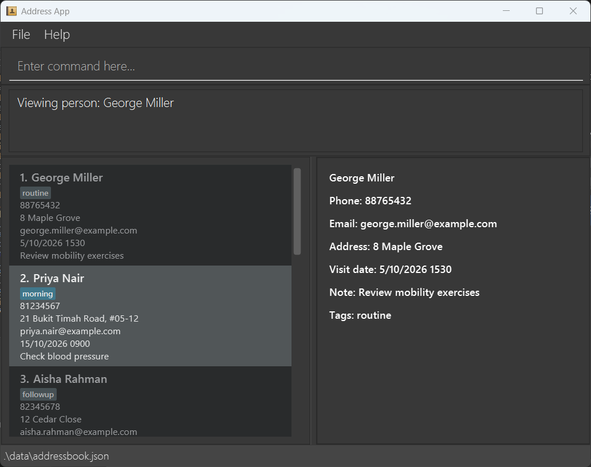
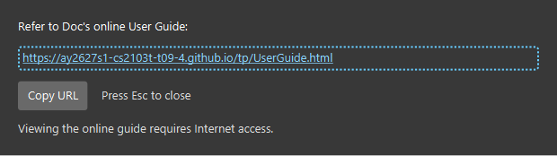

# Doc User Guide

Doc is a **desktop application for house-call doctors to manage patient records and plan home visits**. It is
optimized for use through a Command Line Interface (CLI) while retaining the benefits of a Graphical User Interface
(GUI). If you type quickly, Doc can help you manage your caseload faster than traditional GUI applications.

<!-- * Table of Contents -->
<page-nav-print />

--------------------------------------------------------------------------------------------------------------------

## Quick start

1. Ensure that Java `25` or later is installed on your computer. 
   **Mac users:** Ensure you have the precise JDK version prescribed [here](https://se-education.org/guides/tutorials/javaInstallationMac.html).

1. Download the latest `.jar` file from [here](https://github.com/AY2627S1-CS2103T-T09-4/tp/releases).

1. Copy the file to the folder you want to use as the _home folder_ for Doc.

1. Open a terminal, `cd` to the folder containing the JAR file, and run `java -jar addressbook.jar`. 
   A GUI similar to the one below should appear in a few seconds. Note how the app contains some sample data. 
   

1. Type a command in the command box and press Enter to execute it. For example, type **`help`** and press Enter to open the help window. 
   Some example commands you can try:

   * `list` : Lists all patients.

   * `add n/John Doe p/98765432 e/johnd@example.com a/John street, block 123, #01-01 vd/18/9/2026 1000` : Adds a patient named `John Doe` to Doc.

   * `delete 3` : Asks for confirmation before deleting the 3rd patient shown in the current list.

   * `clear` : Asks for confirmation before deleting all patient records.

   * `exit` : Exits the app.

1. Refer to the [Features](#features) section below for details of each command.

--------------------------------------------------------------------------------------------------------------------

## Features

<box type="info" seamless>

**Notes about the command format:** 

* Words in `UPPER_CASE` are the parameters to be supplied by the user. 
  For example, in `add n/NAME`, replace `NAME` with a value such as `John Doe`.

* Items in square brackets are optional. 
  For example, `n/NAME [t/TAG]` can be used as `n/John Doe t/friend` or as `n/John Doe`.

* Items followed by `...` can appear zero or more times. 
  For example, `[t/TAG]... ` may be omitted, or written as `t/friend` or `t/friend t/family`.

* Prefixed fields can be in any order after any required positional arguments. 
  For example, if the command specifies `n/NAME p/PHONE_NUMBER`, `p/PHONE_NUMBER n/NAME` is also acceptable.

* Positional arguments must follow the command's documented order. 
  For example, `edit INDEX ...` starts with the index, and `next INDEX DATETIME` requires the index before the date
  and time.

* Extraneous parameters for commands that take no parameters, such as `help`, `list`, `exit`, and `clear`, are ignored. 
  For example, `help 123` is interpreted as `help`.

* If you are using a PDF version of this document, be careful when copying and pasting commands that span multiple lines as space characters surrounding line-breaks may be omitted when copied over to the application.
</box>

### Navigating command history

The command box keeps commands submitted during the current application session so that you can reuse or edit them.

* Press <kbd>Up</kbd> to recall the most recently submitted command. Press it again to move to older commands. The
  oldest command remains displayed when there are no earlier commands.
* Press <kbd>Down</kbd> to move towards newer commands. After the newest command, pressing <kbd>Down</kbd> restores the
  unfinished text that was in the command box before you started browsing.
* Commands are recalled exactly as submitted, including spaces. Consecutive commands with exactly the same text are
  kept as one history entry so that navigation does not appear unresponsive. The same command is kept again when
  another command separates the submissions. Both successful and invalid commands are kept.
* Empty ordinary submissions and responses to follow-up prompts, such as `y` for a deletion confirmation, are not
  kept. While a follow-up prompt is pending, any recalled text you submit is still handled as the response to that
  prompt.
* Submitting a new command returns navigation to the newest command. The history is cleared when the application
  closes.

### Viewing help: `help`

Shows a message explaining how to access the help page.

Format: `help`

### Adding a patient: `add`

Adds a patient record to Doc.

Format: `add n/NAME p/PHONE_NUMBER a/ADDRESS vd/VISIT_DATE [e/EMAIL] [note/NOTES] [t/TAG]... `

* `VISIT_DATE` must be a date and time in the format `d/M/yyyy HHmm`, e.g. `18/9/2026 1000`. Past dates are allowed.
* Each current or previous visit date and time must be unique across patients. If another patient's visit record
  already uses the supplied date and time, including a patient hidden by filtering,
  the addition is rejected and the app asks you to choose a different slot.
* `EMAIL` and `NOTES` are optional.
* On success, the app shows `Added patient NAME` and the new patient appears in the list.
* On failure, the app shows `The patient is not added due to: ` followed by the reason, and no patient is added.
* A patient with the same normalized name and phone number as an existing patient is a duplicate and cannot be added.
* If only the name matches an existing patient, the app asks
  `A patient named NAME already exists. Add this patient anyway? Type y to confirm. Any other input cancels.`
* Type `y` and press Enter to add the patient. Surrounding spaces and letter case are ignored. Any other input cancels
  the addition and is not run as a command. Confirmation rechecks that the visit date and time are still available.
* If 7 or more patients already have a visit on the same day (at any time), the app warns you before adding another,
  e.g. `Heads up: you already have 7 visits on Fri, 18 Sep 2026. Add Jane Tan anyway? Type y to confirm. Any other
  input cancels.` Type `y` to add the patient anyway. If the name also matches an existing patient, you are asked to
  confirm the name first and then the busy day.
* For duplicate detection, names are compared without letter case after surrounding whitespace is removed and repeated
  spaces are collapsed to one space. For example, `John Doe`, `john doe`, and `John   Doe` are treated as the same
  name. The accepted name's spelling, capitalization, and internal spacing are still displayed and saved.

Duplicate detection has these limitations:

* It does not recognize nicknames, reordered names, misspellings, transliterations, or equivalent accented forms.
* Phone numbers are compared exactly, so different country-code forms of the same number are not recognized as equal.
* Two different patients with the same normalized name and phone number cannot both be added. Include a distinguishing
  name component, such as a middle name or suffix, or use a different contact number.
* Patients whose intentional name difference consists only of capitalization or spacing will trigger duplicate
  handling.

Visit-time conflict detection has these limitations:

* It compares the parsed date and time exactly to the minute. It does not account for appointment duration, travel
  time, preparation time, or partially overlapping visits.
* It does not manage doctor availability, time zones, recurring visits, or separate schedules for multiple doctors.
* Past datetimes are subject to the same uniqueness rule, including dates retained as previous visits.

<box type="tip" seamless>

**Tip:** A patient can have any number of tags, including zero.
</box>

Examples:
* `add n/John Doe p/98765432 a/John street, block 123, #01-01 vd/18/9/2026 1000 e/JohnDoe@gmail.com note/This man is sick`
* `add n/Betsy Crowe t/friend a/Newgate Prison p/1234567 vd/1/10/2026 1430 t/criminal`

### Listing all patients: `list`

Shows all patient records in Doc.

Format: `list`

Patients with a visit date before today are shown using darker backgrounds and muted text. This visual distinction
also appears in patient lists produced by commands such as `find` and `sort date`. Past patients remain selectable,
and their complete details remain readable in the details panel.

### Sorting visits by date: `sort date`

Sorts the currently displayed patients by visit date and time. Visits today or later are shown first, followed by
past visits.

Format: `sort FIELD`

* `FIELD` must be `date`.
* Today is determined using your computer's local date when you run the command. Earlier times today are included.
* Past visits are visually muted in the patient list, whether or not the list has been sorted.
* Within the upcoming and past groups, visits are ordered by date and time, earliest first.
* The command preserves the current displayed set. For example, `find Tan` followed by `sort date` sorts only the
  matching patients.
* Use the displayed indices for subsequent commands such as `edit` or `delete`.
* `list` shows all patients again in stored order; a new `find` also returns its matches in stored order.
* Running `sort` without a field, or with a field other than `date`, shows the required format and an example command.
* Run `sort date` again to refresh which visits belong to the upcoming and past groups after midnight.

Example:
* `sort date` sorts the currently displayed patients by their visit date and time.

### Viewing a patient's details: `view`

Displays the selected patient's full record in the details panel on the right.

Format: `view INDEX`

* Displays the patient at the specified `INDEX`.
* The index refers to the index number shown in the currently displayed patient list.
* The index **must be a positive integer** 1, 2, 3, ...
* The command works on lists produced by commands such as `find` and `sort date`.
* The currently displayed patient list remains visible on the left.
* The current visit date and time remain visible as `Visit date`. The `Previous visit dates:` section immediately
  below it lists retained datetimes in `d/M/yyyy HHmm` format, oldest first and latest last. The note follows.
* A patient with no previous dates shows `No previous visit dates`. Scroll the details panel to read long records;
  all previous dates are included.
* Viewing a patient does not change their stored details.

Example:
* `view 1` displays the first patient's full record in the details panel.

### Editing a patient: `edit`

Edits an existing patient record in Doc.

Format: `edit INDEX [n/NAME] [p/PHONE] [a/ADDRESS] [vd/DATE_TIME] [e/EMAIL] [note/NOTES] [t/TAG]...`

* Edits the patient at the specified `INDEX`. The index refers to the index number shown in the displayed patient
  list. The index **must be a positive integer** 1, 2, 3, ...
* All editable fields are optional, but at least one must be provided.
* To update the visit date and time, use `vd/` with the format `d/M/yyyy HHmm`
  (e.g., `8/10/2026 1000`). A valid date and time in the past is accepted.
* The visit date and time can be edited by itself. Omitting `vd/` preserves the existing visit date and time.
* Editing preserves any previous visit dates. The current datetime must remain strictly later than the latest
  previous datetime, when one exists.
* Re-entering the selected patient's existing visit date and time is allowed. Changing it to a slot used by another
  patient's current or previous visits is rejected, including hidden patients and edits to other fields.
* Omitted fields, including email and existing notes, keep their values. Use an empty `e/` to clear email.
* Use `note/NOTES` to replace the entire stored note. Use an empty `note/` to clear it; notes can be edited
  without `vd/`. An explicitly empty note counts as a supplied field, even when the note is already empty.
* Leading and trailing spaces and tabs in notes are trimmed; internal spaces are preserved. An empty value
  after trimming clears the note. A recognized prefix preceded by a literal space starts another field,
  even inside notes (e.g., `note/Review medication e/new@example.com` edits both notes and email).
  There is no escaping for literal prefix text.
* Prefixes can appear in any order. Repeated single-valued prefixes, including `note/`, are rejected,
  even when their values are identical or empty. Multiple `t/TAG` prefixes are allowed.
* Editing replaces the stored visit date and time; it does not append a visit-history entry.
  Use `edit ... vd/` to correct an appointment, or [next](#scheduling-the-next-visit-next) to schedule the following visit.
* Existing values will be updated to the input values.
* When editing tags, all of the patient's existing tags are removed; adding tags is not cumulative.
* To remove all of a patient's tags, enter `t/` without a tag after it.
* An edit that would give a patient the same normalized name and phone number as another patient is rejected.
* When an edit changes the patient's name to one already used by another patient with a different phone number, the
  app asks `A patient named NAME already exists. Apply this edit anyway? Type y to confirm. Any other input cancels.`
* Type `y` and press Enter to apply the edit. Surrounding spaces and letter case are ignored. Any other input cancels
  the edit and is not run as a command. Editing other details of a patient whose name is already shared does not ask
  for confirmation again. A confirmed name-duplicate edit rechecks that its requested visit slot is still available.
* When an edit moves a patient's visit to a different day that already has 7 or more visits, the app asks, e.g.
  `Heads up: you already have 7 visits on Fri, 18 Sep 2026. Schedule Jane Tan on that day anyway? Type y to confirm.
  Any other input cancels.` Changing only the time within the same day, or editing other fields, does not ask. If the
  name also matches another patient, you are asked to confirm the name first and then the busy day.
* The normalized-name comparison and duplicate-detection limitations described under `add` also apply to edits.
* The visit-time conflict limitations described under `add` also apply to edits.

Examples:
* `edit 1 vd/8/10/2026 1000` Changes the 1st patient's visit to 8 October 2026 at 10:00.
* `edit 1 p/91234567 vd/8/10/2026 1000 e/johndoe@example.com` Updates the visit, phone number, and email.
* `edit 1 p/91234567 e/johndoe@example.com` Updates the phone number and email, keeping the visit unchanged.
* `edit 1 e/` Clears the email, keeping the visit and other details unchanged.
* `edit 1 note/Patient requests a morning visit` Replaces the notes, keeping all other details unchanged.
* `edit 1 note/` Clears the notes, keeping all other details unchanged.
* `edit 1 e/ note/` Clears both email and notes, keeping the visit and other details unchanged.
* `edit 1 vd/8/10/2026 1000 e/new@example.com note/Review medication` Updates the visit, email, and notes.
* `edit 2 n/Betsy Crower t/` Updates the name and clears all existing tags, keeping the visit unchanged.

### Scheduling the next visit: `next`

Schedules a patient's following appointment and retains the current visit date and time in their visit record.
Use `next` after handling the current visit and planning another. Retained dates do not verify attendance or
completion. Use `edit ... vd/` to correct or reschedule an existing appointment without adding a previous date.

Format: `next INDEX DATETIME`

* Use a positive `INDEX` from the currently displayed list, including results of `find` or `sort date`.
  `view` keeps that list and its indices unchanged.
* Enter `DATETIME` as `d/M/yyyy HHmm`, with a four-digit 24-hour time. Spaces or tabs separate the arguments;
  repeated and outer whitespace are accepted. Do not use `vd/`, quotation marks, or extra arguments.
* The current visit must be at or before your computer's current local time at execution. If it is still in the
  future, use `edit ... vd/` to reschedule it.
* The requested appointment must be strictly after that execution time; the current minute's start is rejected.
* The requested appointment must differ from every other patient's current and previous visit dates and times,
  including hidden patients. Leading-zero dates compare equally: `1/11/2026 0930` and `01/11/2026 0930` are the same time.
* Conflict detection covers identical start times, not visit duration, travel time, or partial overlaps.
  The [visit-time conflict limitations under add](#adding-a-patient-add) also apply.
* Success appends the old current date and time to the previous dates, then sets the new current date and time.
  All other details, including empty optional fields, are preserved. Previous dates are saved in order in the
  JSON data file and appear below the current visit date when you run `view INDEX`.
* If no further visit is planned, leave the current date and time unchanged, even after it passes.
* Success shows `Next visit scheduled for patient NAME: DATETIME`, saves the record, and restores the full list in
  stored order, clearing the filter and sort. Check the new indices; run `view` again to refresh the details panel.
* Validation errors preserve data and the displayed list. A save failure reports a storage error; the in-memory
  appointment may already have changed.

Common errors:

| Input problem | Feedback |
| --- | --- |
| Current visit still in the future | `Patient NAME has a current visit at DATETIME that is still in the future. Use edit to reschedule it.` |
| Time at or before now | `The next visit must be later than the current time (DATETIME). Choose a later date and time.` |
| Unchanged appointment | `Patient NAME already has an appointment at DATETIME.` |
| Another patient's current or previous visit | `Patient NAME already has a current or previous visit at DATETIME. Choose a different date and time.` |

Bare `next` shows usage. Missing or extra arguments, `vd/` syntax, and incorrect index syntax show a reason and usage.
Invalid dates show the required format; an index outside the displayed list shows the existing invalid-index error.
The current time in the error uses `d/M/yyyy HHmm`, without seconds; validation still uses the full execution time.

Examples (the selected patient's current visit must have arrived or passed; choose an unused future datetime):

* `next 1 1/11/2026 0930` schedules the first displayed patient's next appointment for 1 November 2026 at 09:30.
* `find Betsy`, then `next 1 2/11/2026 1430`, schedules the first matching patient and restores the full list.

### Locating patients by name: `find`

Finds patients with a word in their name that starts with any of the given keywords.

Format: `find KEYWORD [MORE_KEYWORDS]`

* The search is case-insensitive; for example, `hans` matches `Hans`.
* A keyword matches the start of any word in the name, whether first name or surname. For example, `b` matches
  `Bernice Yu` and `Roy Balakrishnan`, and `Han` matches `Hans`.
* A keyword in the middle of a word does not match; for example, `ans` does not match `Hans`.
* Keyword order does not matter; for example, `Hans Bo` matches `Bo Hans`.
* The search considers only names.
* Patients matching at least one keyword are returned (an `OR` search); for example, `Hans Bo` returns `Hans Gruber` and `Bo Yang`.
* The app shows how many patients were found, e.g. `3 patients found.` If none match, it shows `No patients found.`
  with a reminder of how keywords are matched.

Examples:
* `find b` returns `Bernice Yu` and `Roy Balakrishnan`
* `find John` returns `john` and `John Doe`
* `find alex david` returns `Alex Yeoh`, `David Li` 
  

### Deleting a patient: `delete`

Deletes the specified patient record from Doc.

Format: `delete INDEX`

* Deletes the patient at the specified `INDEX`.
* The index refers to the index number shown in the displayed patient list.
* The index **must be a positive integer** 1, 2, 3, ...
* A valid command displays `Delete NAME? Type y to confirm. Any other input cancels.` without deleting the patient.
* Type `y` and press Enter to confirm. Surrounding spaces and letter case are ignored.
* Any other input, including an empty response or another valid command, cancels the deletion and is not run as a
  command. The result display then shows `Deletion cancelled.`
* Invalid `delete` commands continue to show the usual invalid-command response and do not ask for confirmation.

Examples:
* `list` followed by `delete 2`, then `y`, deletes the 2nd patient in Doc.
* `find Betsy` followed by `delete 1`, then `y`, deletes the 1st patient in the results of the `find` command.

### Clearing all entries: `clear`

Clears all patient records from Doc.

Format: `clear`

* When Doc contains patient records, the result display asks for confirmation and shows the number of entries
  that will be cleared.
* Type `y` and press Enter to confirm. Surrounding spaces and letter case are ignored.
* Any other input, including an empty response or another valid command, cancels the clear operation and is not run as
  a command. The result display then shows `Clear cancelled.`
* If Doc has no patient records, no confirmation is requested and the result display shows
  `Address book is already empty.`

Example: `clear` followed by `y` clears every entry.

### Exiting the program: `exit`

Exits the program.

Format: `exit`

### Saving the data

Doc automatically saves data after completed commands. Confirmation prompts, cancelled operations, and
`clear` when there are no patient records do not write a file because they do not change stored data. You do not need
to save manually.

### Editing the data file

Doc's patient data is saved automatically as a JSON file at `[JAR file location]/data/addressbook.json`. Advanced
users may update the data directly by editing that file.

Each patient has a required `visitDate` and a `previousVisitDates` array of datetime strings in `d/M/yyyy HHmm`
format. Previous dates must be strictly increasing, oldest first, and earlier than the current date. All current
and previous datetimes must be unique across patients. Missing or `null` previous-date arrays in older files load
as empty arrays. Invalid records are rejected without sorting, deduplicating, or dropping entries.

<box type="warning" seamless>

**Caution:**
If your changes make the data file invalid, Doc starts with an empty patient list at the next run. The invalid
file remains on disk until you run a command that triggers saving, such as `list`. Still, we recommend backing up the
file before editing it. 
Furthermore, certain edits can cause Doc to behave in unexpected ways (e.g., if a value entered is outside the
acceptable range). Therefore, edit the data file only if you are confident that you can update it correctly.
Files created by older versions can also be invalid if two patient records use the same visit date and time. Assign a
different visit slot to each record before opening such a file with this version.
</box>

### Archiving data files `[coming in v2.0]`

_Details coming soon ..._

--------------------------------------------------------------------------------------------------------------------

## FAQ

**Q**: How do I transfer my data to another computer? 
**A**: Install Doc on the other computer and overwrite the data file it creates with the data file from your previous
Doc home folder.

--------------------------------------------------------------------------------------------------------------------

## Known issues

1. **When using multiple screens**, if you move the application to a secondary screen, and later switch to using only the primary screen, the GUI will open off-screen. The remedy is to delete the `preferences.json` file created by the application before running the application again.
2. **If you minimize the Help Window** and then run the `help` command (or use the `Help` menu, or the keyboard shortcut `F1`) again, the original Help Window will remain minimized, and no new Help Window will appear. The remedy is to manually restore the minimized Help Window.

--------------------------------------------------------------------------------------------------------------------

## Command summary

Action     | Format, Examples
-----------|----------------------------------------------------------------------------------------------------------------------------------------------------------------------
**Add**    | `add n/NAME p/PHONE_NUMBER a/ADDRESS vd/VISIT_DATE [e/EMAIL] [note/NOTES] [t/TAG]... `   e.g., `add n/James Ho p/22224444 a/123, Clementi Rd, 1234665 vd/18/9/2026 1000 e/jamesho@example.com t/friend t/colleague`
**Clear**  | `clear`
**Delete** | `delete INDEX`  e.g., `delete 3`
**Edit**   | `edit INDEX [n/NAME] [p/PHONE_NUMBER] [a/ADDRESS] [vd/DATE_TIME] [e/EMAIL] [note/NOTES] [t/TAG]...`  e.g., `edit 2 note/Review medication`
**Find**   | `find KEYWORD [MORE_KEYWORDS]`  e.g., `find James Jake`
**List**   | `list`
**Next**   | `next INDEX DATETIME`  e.g., `next 1 1/11/2026 0930` (current visit must have arrived or passed; use an unused future datetime)
**Sort**   | `sort date`
**View**   | `view INDEX`  e.g., `view 1`
**Help**   | `help`
